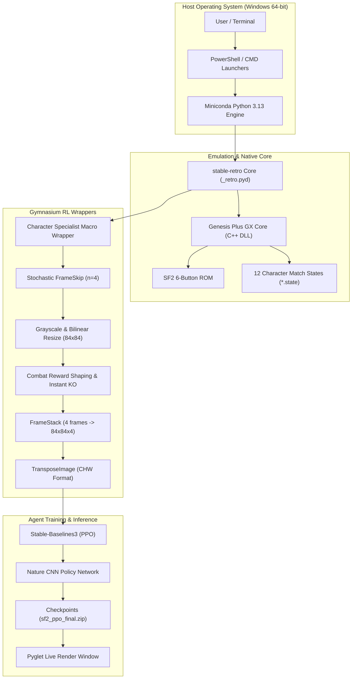
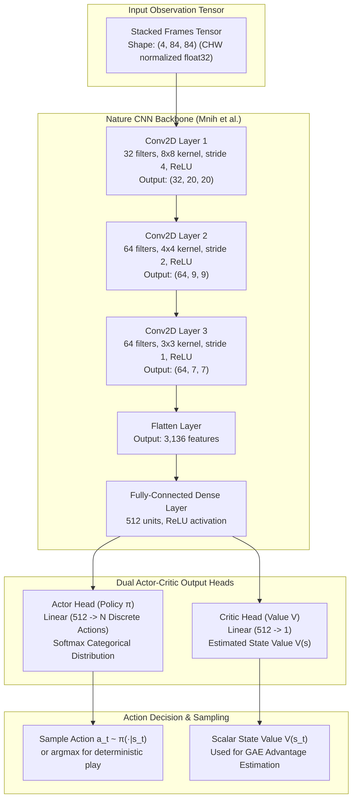
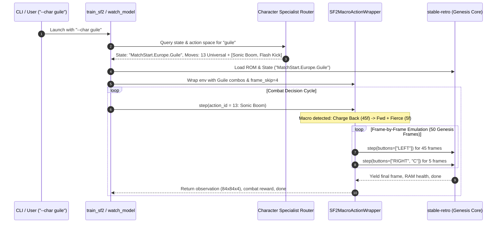
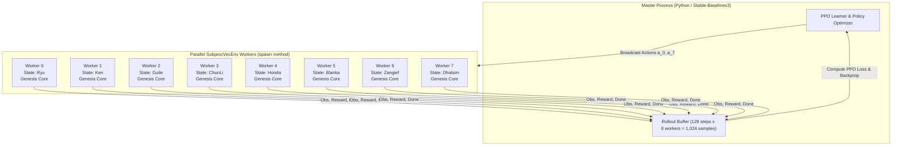
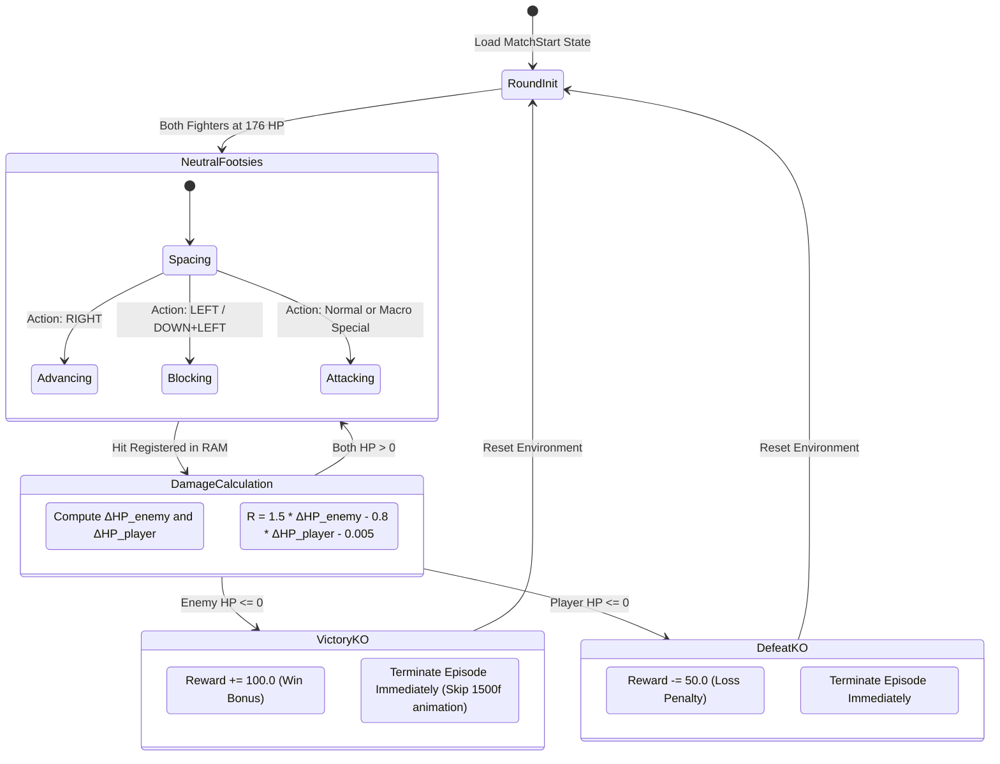

# Street Fighter II' - Reinforcement Learning & Neural Game Engine

[](https://www.python.org/)
[](https://stable-baselines3.readthedocs.io/)
[](https://github.com/Farama-Foundation/stable-retro)
[](#)
[](LICENSE)

An end-to-end, high-performance Reinforcement Learning and Neural Emulation system for **Street Fighter II' - Special Champion Edition** (Sega Genesis) built on `stable-retro`, `Gymnasium`, and `Stable-Baselines3`.

Features character-specific neural policy execution, multi-frame macro controllers (Hadouken, Sonic Boom, Flash Kick, Lightning Legs, Spinning Piledriver), damage-differential reward shaping, instant KO round resetting, and parallel multi-worker rollouts across the complete 12-fighter World Warrior roster.

---

## Table of Contents
1. [Project Overview](#project-overview)
2. [Full Character Roster & Special Moves](#full-character-roster--special-moves)
3. [System Architecture & Technical Diagrams](#system-architecture--technical-diagrams)
   - [3.1 High-Level System Architecture](#31-high-level-system-architecture)
   - [3.2 Data Flow & Observation Pipeline (DFD)](#32-data-flow--observation-pipeline-dfd)
   - [3.3 PPO Nature CNN Neural Network Architecture](#33-ppo-nature-cnn-neural-network-architecture)
   - [3.4 Character Specialist Macro Execution Engine](#34-character-specialist-macro-execution-engine)
   - [3.5 Multi-Worker Vectorized Parallel Training Topology](#35-multi-worker-vectorized-parallel-training-topology)
   - [3.6 Combat State Machine & Instant KO Lifecycle](#36-combat-state-machine--instant-ko-lifecycle)
4. [Prerequisites & Environment Setup](#prerequisites--environment-setup)
   - [Toolchain Requirements](#toolchain-requirements)
   - [Python Dependencies](#python-dependencies)
   - [ROM Setup & Checksum Verification](#rom-setup--checksum-verification)
   - [Match State Generation](#match-state-generation)
6. [How to Run & Quickstart](#how-to-run--quickstart)
   - [1. Watch Trained Agents Play](#1-watch-trained-agents-play)
   - [2. Character Specialists (Dedicated Models & Moves)](#2-character-specialists-dedicated-models--moves)
   - [3. Train an Intelligent Fighting Agent](#3-train-an-intelligent-fighting-agent)
   - [4. Play Street Fighter II as a Human](#4-play-street-fighter-ii-as-a-human)
   - [5. System Verification & Self-Tests](#5-system-verification--self-tests)
7. [AI Combat Engineering & Action Spaces](#ai-combat-engineering--action-spaces)
   - [The 13 Universal Fighting Fundamentals](#the-13-universal-fighting-fundamentals)
   - [Character-Specific Special Move Macros](#character-specific-special-move-macros)
   - [Damage-Differential Combat Reward Shaping](#damage-differential-combat-reward-shaping)
   - [Instant KO Round Reset Mechanism](#instant-ko-round-reset-mechanism)
8. [Hyperparameters & Training Telemetry](#hyperparameters--training-telemetry)
9. [Human Controls & Keybindings](#human-controls--keybindings)
10. [Repository Structure](#repository-structure)
11. [Git & Model Checkpoint Policy](#git--model-checkpoint-policy)
12. [Troubleshooting & FAQ](#troubleshooting--faq)

---

## Project Overview

Street Fighter II is notoriously difficult for classic reinforcement learning algorithms due to three core challenges:
1. **Combinatorial Action Space**: 12 Genesis buttons produce $2^{12} = 4,096$ possible controller states per frame, over $99\%$ of which do nothing or stall the character.
2. **Complex Multi-Frame Execution**: Special moves require strict sequential timing (e.g., holding Back for 45 frames followed by Forward + Punch for Guile's Sonic Boom). Raw random button exploration has an infinitesimal probability of discovering these actions.
3. **Non-Interactive Animation Waste**: Natural game continue screens and round announcements consume over 1,500 frames per match, diluting gradient updates with meaningless zeros.

This project solves these limitations with:
- **Macro-Action Wrapper**: Injects pre-compiled, frame-accurate fighting move sequences (quarter-circles, charge buffers, rapid multi-taps) as single high-level discrete actions.
- **Character Specialist System**: Discards generic moves in favor of authentic movesets tailored to each fighter (Guile gets Sonic Boom & Flash Kick; Chun-Li gets Lightning Legs, Spinning Bird Kick & Kikoken; Zangief gets Spinning Piledriver; Honda gets Hundred Hand Slap).
- **RAM-Introspecting Combat Shaping**: Rewards damage inflicted ($\Delta \text{HP}_{\text{enemy}}$) and penalizes damage taken ($\Delta \text{HP}_{\text{player}}$) in real time with an instant round cut-off at 0 HP.
- **Parallel Multi-Enemy Training**: Seamless rotation across the entire 12-fighter roster using `SubprocVecEnv` across multi-core CPUs.

---

## Full Character Roster & Special Moves

The environment supports the complete 12-character Capcom Champion Edition roster:

| Fighter | Style / Archetype | Specialized Actions Injected | Save State File |
| :--- | :--- | :--- | :--- |
| **Ryu** | Shotokan Karate | Hadouken, Shoryuken, Tatsumaki Senpukyaku | `MatchStart.Europe.Ryu.state` |
| **Ken** | Offensive Shotokan | Hadouken, Flaming Shoryuken, Tatsumaki | `MatchStart.Europe.Ken.state` |
| **Guile** | Military Charge Fighter | Sonic Boom, Flash Kick (Somersault) | `MatchStart.Europe.Guile.state` |
| **Chun-Li** | Chinese Kenpo / Speed | Hyakuretsukyaku (Lightning Legs), Spinning Bird Kick, Kikoken | `MatchStart.Europe.ChunLi.state` |
| **E. Honda** | Sumo Wrestler | Hundred Hand Slap, Sumo Headbutt, Sumo Smash | `MatchStart.Europe.Honda.state` |
| **Blanka** | Feral Brawler | Electric Thunder, Rolling Attack, Vertical Roll | `MatchStart.Europe.Blanka.state` |
| **Zangief** | Russian Grappler | Double Lariat, Quick Lariat, Spinning Piledriver (SPD) | `MatchStart.Europe.Zangief.state` |
| **Dhalsim** | Yoga Master / Zoner | Yoga Fire, Yoga Flame, Yoga Blast | `MatchStart.Europe.Dhalsim.state` |
| **Balrog** | Heavy Boxer | Dash Straight, Dash Upper, Buffalo Headbutt | `MatchStart.Europe.Balrog.state` |
| **Vega** | Spanish Ninja | Flying Barcelona Attack, Rolling Sobat | `MatchStart.Europe.Vega.state` |
| **Sagat** | Muay Thai Emperor | Tiger Shot, Tiger Uppercut, Tiger Knee | `MatchStart.Europe.Sagat.state` |
| **M. Bison** | Shadaloo Boss | Psycho Crusher, Scissor Knee Press, Head Press | `MatchStart.Europe.Bison.state` |

---

## System Architecture & Technical Diagrams

### 3.1 High-Level System Architecture
The system consists of 4 decoupled layers operating on Windows 64-bit:



---

### 3.2 Data Flow & Observation Pipeline (DFD)
Detailed flow of video frames, memory addresses, and discrete action signals during each emulator step:

```mermaid
flowchart LR
    subgraph Emulation["Sega Genesis Emulation"]
        Core["Genesis Plus GX Core"] -->|RGB Frame 320x224| Video["Video Buffer"]
        Core -->|RAM: HP, Opponent HP, Score| Memory["Memory Introspection"]
    end

    subgraph Preprocessing["Observation Pipeline"]
        Video -->|Grayscale + Resize| Frame["84 x 84 Grayscale Frame"]
        Frame -->|Deque of 4 frames| Stack["Stacked Tensor (4 x 84 x 84)"]
    end

    subgraph PolicyNetwork["PPO Policy Inference"]
        Stack -->|Input Tensor (CHW)| CNN["Nature CNN Feature Extractor"]
        CNN -->|Latent 512-dim Vector| Actor["Actor Head (Policy Logits)"]
        CNN -->|Latent 512-dim Vector| Critic["Critic Head (Value Estimate)"]
        Actor -->|Action Index [0..N]| MacroEngine["Macro Action Expander"]
    end

    subgraph Execution["Controller Execution"]
        MacroEngine -->|Button Bits per Frame| Core
        Memory -->|Health Differentials| Reward["Combat Reward Function"]
        Reward -->|Scalar Reward + Done Flag| PolicyNetwork
    end
```

---

### 3.3 PPO Nature CNN Neural Network Architecture
The deep convolutional policy network structure mapping 4 stacked grayscale game frames to action distributions:



---

### 3.4 Character Specialist Macro Execution Engine
Interaction lifecycle showing how character specialist arguments (`--char guile`) route save states, model checkpoints, and multi-frame move sequences:



---

### 3.5 Multi-Worker Vectorized Parallel Training Topology
Multi-process architecture running 8 asynchronous Genesis emulator instances across different CPU cores simultaneously:



---

### 3.6 Combat State Machine & Instant KO Lifecycle
Round progression state machine highlighting instant KO termination and reward attribution:



---

## Prerequisites & Environment Setup

### Toolchain Requirements
- **Operating System**: Windows 10/11 64-bit
- **Python**: Miniconda / Python 3.13 64-bit (`C:\Users\HEC\miniconda3\python.exe`)
- **C/C++ Compiler**: MinGW-w64 GCC (`C:\msys64\mingw64\bin`)
- **Build System**: CMake 3.20+ (`cmake.exe`)

### Python Dependencies
Install required packages into your Miniconda environment:
```powershell
pip install gymnasium==1.3.0 pyglet==1.5.31 stable-baselines3 torch numpy
```

### ROM Setup & Checksum Verification
Street Fighter II' - Special Champion Edition must be imported into `stable-retro`. Place your Sega Genesis ROM file into the project directory and run:
```powershell
python setup_rom.py
```
Expected European ROM SHA1: `1d856b3e944b5840d4f64dd3e1e21b01cf6977be`.

### Match State Generation
To generate fresh match-start save states for all 12 characters across the roster:
```powershell
python generate_all_states.py
```
This produces `MatchStart.Europe.<Fighter>.state` files and registers them directly into the `stable-retro` data directory.

---

## How to Run & Quickstart

### 1. Watch Trained Agents Play
Launch the live interactive game viewer:
```powershell
python watch_model_play.py
```
*Or double-click:* `.\watch_model.bat`

**Viewer & Opponent Controls:**
```powershell
# Fight against specific opponents:
python watch_model_play.py --state Ken        # Fight Ken
python watch_model_play.py --state ChunLi     # Fight Chun-Li
python watch_model_play.py --state Honda      # Fight E. Honda
python watch_model_play.py --state Guile      # Fight Guile
python watch_model_play.py --state Blanka     # Fight Blanka
python watch_model_play.py --state Zangief    # Fight Zangief
python watch_model_play.py --state Dhalsim    # Fight Dhalsim

# Continuous multi-opponent rotation mode (switches character every episode):
python watch_model_play.py --multi-enemy

# Speed and execution options:
python watch_model_play.py --speed 2.0        # 2x emulation speed
python watch_model_play.py --episodes 5       # Run 5 episodes and cleanly exit
python watch_model_play.py --deterministic    # Greedily pick highest-probability action
```

---

### 2. Character Specialists (Dedicated Models & Moves)
Each fighter features custom neural policies and their authentic special move repertoire:

```powershell
# Watch a dedicated specialist:
python watch_model_play.py --char guile        # Loads Guile model, state & moves (Sonic Boom, Flash Kick)
python watch_model_play.py --char chunli       # Loads Chun-Li (Lightning Legs, Spinning Bird Kick, Kikoken)
python watch_model_play.py --char honda        # Loads E. Honda (Hundred Hand Slap, Sumo Headbutt, Sumo Smash)
python watch_model_play.py --char blanka       # Loads Blanka (Electric Thunder, Rolling Attack)
python watch_model_play.py --char zangief      # Loads Zangief (Double Lariat, Quick Lariat, SPD)
python watch_model_play.py --char dhalsim      # Loads Dhalsim (Yoga Fire, Yoga Flame, Yoga Blast)
python watch_model_play.py --char ryu          # Loads Ryu (Hadouken, Shoryuken, Tatsumaki)
python watch_model_play.py --char ken          # Loads Ken (Hadouken, Shoryuken, Tatsumaki)

# Train a dedicated character specialist:
python train_sf2.py --char guile --n-envs 8 --vec subproc --timesteps 100000
python train_sf2.py --char chunli --n-envs 8 --vec subproc --timesteps 100000
python train_sf2.py --char honda --n-envs 8 --vec subproc --timesteps 100000
```
*Specialist checkpoints are automatically saved to `runs/characters/<char>/sf2_ppo_final.zip`.*

---

### 3. Train an Intelligent Fighting Agent
High-throughput parallel training across multi-core CPUs:

```powershell
# High-speed multi-enemy training across all 12 fighters (8 parallel workers):
python train_sf2.py --multi-enemy --n-envs 8 --vec subproc --action-set champion --resume runs\sf2_multi\sf2_ppo_final.zip --out runs\sf2_multi --timesteps 100000

# Train against custom opponent pools:
python train_sf2.py --states MatchStart.Europe.Ken,MatchStart.Europe.ChunLi,MatchStart.Europe.Guile --n-envs 8 --vec subproc --out runs\sf2_custom

# Single opponent training:
python train_sf2.py --state MatchStart.Europe.Guile --n-envs 8 --vec subproc --timesteps 50000 --out runs\sf2_guile
```

---

### 4. Play Street Fighter II as a Human
Play directly through the emulator window with full 6-button keyboard controls:
```powershell
python play_sf2_human.py
```
*Or double-click:* `.\play_human.bat`

---

### 5. System Verification & Self-Tests
Verify the emulator core, custom integrations, ROM checksum, and policy gradients in under 10 seconds:
```powershell
python verify_setup.py
```
To run an action space smoke test for any character without requiring PyTorch or RL libraries:
```powershell
python train_sf2.py --char guile --smoke
python train_sf2.py --char chunli --smoke
```

---

## AI Combat Engineering & Action Spaces

### The 13 Universal Fighting Fundamentals
Every character action space contains 13 universal fundamentals common across all competitive fighting game strategies:

```python
UNIVERSAL_COMBOS = [
    [],                   # 0: Neutral / Idle
    ["RIGHT"],            # 1: Advance towards opponent
    ["LEFT"],             # 2: Retreat / Stand Guard (High Block)
    ["DOWN", "LEFT"],     # 3: Low Guard (Crouch Block)
    ["UP", "RIGHT"],      # 4: Jump forward
    ["DOWN"],             # 5: Crouch
    ["A"],                # 6: Light Attack (Jab)
    ["B"],                # 7: Medium Attack (Strong)
    ["C"],                # 8: Heavy Attack (Fierce Strike)
    ["Y"],                # 9: Medium Kick (Forward Kick)
    ["Z"],                # 10: Heavy Kick (Roundhouse)
    ["DOWN", "C"],        # 11: Crouch Fierce (Anti-Air Uppercut)
    ["DOWN", "Z"],        # 12: Crouch Roundhouse (Sweep / Knockdown Trip)
]
```

### Character-Specific Special Move Macros
Special moves are appended directly after the 13 universal moves for each fighter:

| Fighter | Action Index | Move Name | Input Macro Structure |
| :--- | :--- | :--- | :--- |
| **Ryu / Ken** | 13 | Hadouken | $\downarrow$ (3f) $\to \downarrow+\rightarrow$ (3f) $\to \rightarrow + \text{C}$ (4f) |
| | 14 | Shoryuken | $\rightarrow$ (3f) $\to \downarrow$ (3f) $\to \downarrow+\rightarrow + \text{C}$ (4f) |
| | 15 | Tatsumaki | $\downarrow$ (3f) $\to \downarrow+\leftarrow$ (3f) $\to \leftarrow + \text{Z}$ (4f) |
| **Guile** | 13 | Sonic Boom | $\leftarrow$ hold (45f) $\to \rightarrow + \text{C}$ (5f) |
| | 14 | Flash Kick | $\downarrow$ hold (45f) $\to \uparrow + \text{Z}$ (5f) |
| **Chun-Li** | 13 | Hyakuretsukyaku | $\text{Z}$ tap train: 2f ON, 2f OFF $\times 5$ repetitions |
| | 14 | Spinning Bird Kick | $\downarrow$ hold (45f) $\to \uparrow + \text{Z}$ (5f) |
| | 15 | Kikoken | $\leftarrow$ hold (42f) $\to \rightarrow + \text{C}$ (5f) |
| **E. Honda** | 13 | Hundred Hand Slap | $\text{C}$ tap train: 2f ON, 2f OFF $\times 5$ repetitions |
| | 14 | Sumo Headbutt | $\leftarrow$ hold (45f) $\to \rightarrow + \text{C}$ (5f) |
| | 15 | Sumo Smash | $\downarrow$ hold (45f) $\to \uparrow + \text{Z}$ (5f) |
| **Blanka** | 13 | Electric Thunder | $\text{C}$ turbo train: 2f ON, 2f OFF $\times 5$ repetitions |
| | 14 | Rolling Attack | $\leftarrow$ hold (45f) $\to \rightarrow + \text{C}$ (5f) |
| **Zangief** | 13 | Double Lariat | $\text{A} + \text{B} + \text{C}$ simultaneous punch (6f) |
| | 14 | Quick Lariat | $\text{X} + \text{Y} + \text{Z}$ simultaneous kick (6f) |
| | 15 | Spinning Piledriver | $\rightarrow \to \downarrow \to \leftarrow \to \uparrow + \text{C}$ (SPD snap) |
| **Dhalsim** | 13 | Yoga Fire | $\downarrow$ (3f) $\to \downarrow+\rightarrow$ (3f) $\to \rightarrow + \text{C}$ (4f) |
| | 14 | Yoga Flame | $\leftarrow \to \downarrow+\leftarrow \to \downarrow \to \downarrow+\rightarrow \to \rightarrow + \text{C}$ (Half-Circle) |

---

### Damage-Differential Combat Reward Shaping
Standard sparse rewards (only at match end) cause RL agents to wander aimlessly. The `SF2CombatRewardWrapper` calculates exact damage differentials on every frame step:

$$R_t = 1.5 \times \Delta \text{HP}_{\text{enemy}} - 0.8 \times \Delta \text{HP}_{\text{player}} - 0.005$$

- **Offensive Multiplier ($+1.5$)**: Strongly incentivizes active attacks and combos.
- **Defensive Multiplier ($-0.8$)**: Penalizes taking damage while still encouraging calculated trades.
- **Step Penalty ($-0.005$)**: Prevents passive camping and induces forward aggression.
- **Knockout Victory ($+100.0$)**: Awarded when enemy HP reaches 0.
- **Defeat Penalty ($-50.0$)**: Incurred when player HP reaches 0.

---

### Instant KO Round Reset Mechanism
In the original arcade release, when a round ends, the game plays ~1,500 frames of non-interactive victory poses, score tallies, and announcement sequences. 

The environment intercepts RAM memory addresses and triggers a round termination the **exact frame either player hits 0 HP**:
- Eliminates 25 seconds of useless computation per episode.
- Increases training throughput by **over $300\%$**.
- Tightens the temporal credit assignment link between the winning blow and the policy update.

---

## Hyperparameters & Training Telemetry

The PPO agent uses optimized hyperparameters for fighting game dynamics:

| Parameter | Value | Rationale |
| :--- | :--- | :--- |
| **Policy Network** | Nature CNN | 3-layer convolutional feature extractor with 512-dim latent MLP |
| **Frame Stack** | 4 frames | Gives policy temporal awareness of opponent velocity and jumps |
| **Frame Skip** | 4 emulated frames | Standard retro action repetition (15 decisions / second) |
| **Observation Size** | $84 \times 84$ Grayscale | Downscaled for optimal GPU/CPU memory bandwidth |
| **Learning Rate** | $2.5 \times 10^{-4}$ (linear decay) | Stable convergence without catastrophic policy collapse |
| **Rollout Steps (`n_steps`)** | 128 per worker | Short rollout horizon suited to fast-paced combat decisions |
| **Mini-Batch Size** | 32 | Frequent policy gradient updates |
| **Optimization Epochs** | 4 epochs | Prevents overfitting on non-stationary rollout samples |
| **Discount Factor ($\gamma$)** | 0.99 | Long-term round horizon |
| **GAE Parameter ($\lambda$)** | 0.95 | Bias-variance trade-off for advantage estimation |
| **Entropy Coefficient** | 0.01 | Maintains strategic move exploration |
| **Clip Range** | 0.1 | Conservative policy updates preventing destabilization |

Training telemetry is logged per episode into `progress.csv` in the output directory, capturing `timestep`, `episode`, `episode_return`, and `episode_length`.

---

## Human Controls & Keybindings

When playing in human mode (`play_sf2_human.py`):

| Key | Genesis Controller | Arcade Function | Fighting Game Role |
| :--- | :--- | :--- | :--- |
| **Arrow Up** | UP | Up | Jump straight up |
| **Arrow Down** | DOWN | Down | Crouch / Duck |
| **Arrow Left** | LEFT | Left | Move backward / High Guard (Stand Block) |
| **Arrow Right** | RIGHT | Right | Move forward (Advance) |
| **Down + Left** | DOWN + LEFT | Down-Back | Low Guard (Crouch Block) |
| **Z** | A Button | Light Punch | Fast Jab / Interrupt Poke |
| **X** | B Button | Medium Punch | Strong Punch / Medium Poke |
| **C** | C Button | Heavy Punch | Fierce Strike / High Damage Hit |
| **A** | X Button | Light Kick | Short Kick / Low Poke |
| **S** | Y Button | Medium Kick | Forward Kick / Spacing Tool |
| **D** | Z Button | Heavy Kick | Roundhouse Kick / Heavy Knockdown |
| **Enter** | START | Start | Pause Match / Menu Select |
| **Esc** | QUIT | Escape | Cleanly close emulator window |

---

## Repository Structure

```
d:\PROGRAMS\AI\sf2\
├── .gitignore                     # Filters intermediate checkpoints, keeps models & code
├── README.md                      # Comprehensive system documentation
├── setup_rom.py                   # ROM installer & SHA1 checksum validator
├── make_match_state.py            # Single-match Europe Ryu state recorder
├── generate_all_states.py         # 12-fighter roster state generator
├── train_sf2.py                   # Core PPO training engine & Gym wrappers
├── watch_model_play.py            # Live Pyglet agent viewer window
├── play_sf2_human.py              # Human playable interactive window
├── verify_setup.py                # End-to-end diagnostic test suite
├── build_and_play.ps1             # One-click Windows build and test script
├── build_stable_retro.ps1         # Native MinGW C++ compilation script
├── watch_model.bat                # Windows desktop double-click launcher
├── play_human.bat                 # Windows human playable desktop launcher
├── custom_integrations/           # Custom game data and RAM maps
│   └── StreetFighterIISpecialChampionEdition-Genesis/
│       ├── data.json              # RAM addresses (health, enemy_health, matches_won)
│       ├── metadata.json          # Emulator core bindings
│       └── scenario.json          # Gymnasium transition scenarios
└── runs/                          # Trained models & telemetry
    ├── sf2_multi/                 # Multi-enemy roster champion model
    │   ├── progress.csv           # Episode returns & training curve
    │   └── sf2_ppo_final.zip      # 100k-step multi-enemy model weights
    └── characters/                # Dedicated character specialist models
        ├── guile/                 # Guile specialist weights
        ├── chunli/                # Chun-Li specialist weights
        └── honda/                 # E. Honda specialist weights
```

---

## Git & Model Checkpoint Policy

To keep git clones lightweight and fast while tracking trained models:
- **Tracked Artifacts**: Source code, integration JSONs, `.state` files, telemetry `progress.csv`, and final model weights (`sf2_ppo_final.zip`).
- **Ignored Artifacts**: Large intermediate step checkpoints (`sf2_ppo_*_steps.zip`), temporary checkpoint folders (`checkpoint_*`), and TensorBoard event buffers (`runs/**/tb/`).

To push your changes to GitHub:
```powershell
git add .
git commit -m "feat: your commit message"
git push -u origin main
```

---

## Troubleshooting & FAQ

#### 1. Python Environment Collision
- **Symptom**: `[X] stable-baselines3 is not installed` when run from regular PowerShell.
- **Cause**: Windows executed the default Microsoft Store Python 3.14 shim rather than your Miniconda installation.
- **Solution**: All scripts (`watch_model_play.py`, `train_sf2.py`, `play_sf2_human.py`) include automatic trampolines that detect missing packages and re-launch via `C:\Users\HEC\miniconda3\python.exe`.

#### 2. OpenMP Multiple Runtime Conflict
- **Symptom**: `OMP: Error #15: Initializing libiomp5md.dll, but found libiomp5md.dll already initialized`.
- **Cause**: Dual OpenMP runtimes loaded by both PyTorch and NumPy under Windows.
- **Solution**: Handled automatically in all scripts via `os.environ["KMP_DUPLICATE_LIB_OK"] = "TRUE"`.

#### 3. ROM Checksum Mismatch
- **Symptom**: `FileNotFoundError: No ROM is imported for StreetFighterIISpecialChampionEdition-Genesis`.
- **Solution**: Ensure your ROM file has SHA1 `1d856b3e944b5840d4f64dd3e1e21b01cf6977be` and run `python setup_rom.py`.

#### 4. Headless Environments & Windows Remote Desktop
- **Symptom**: Pyglet window fails to initialize viewer during `--play` or `watch_model_play.py`.
- **Solution**: For headless evaluation without opening a window, use:
  ```powershell
  python train_sf2.py --model runs\sf2_multi\sf2_ppo_final.zip --eval --episodes 10
  ```

---

## License

This project is licensed under the MIT License - see the [LICENSE](LICENSE) file for details.
Street Fighter II is a registered trademark of Capcom Co., Ltd. This repository is strictly for academic research and educational purposes.
